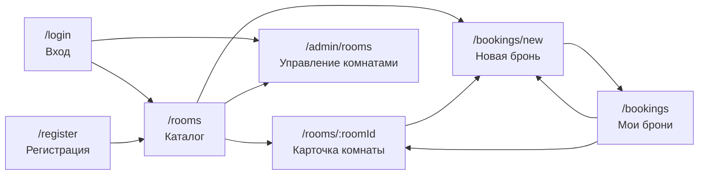
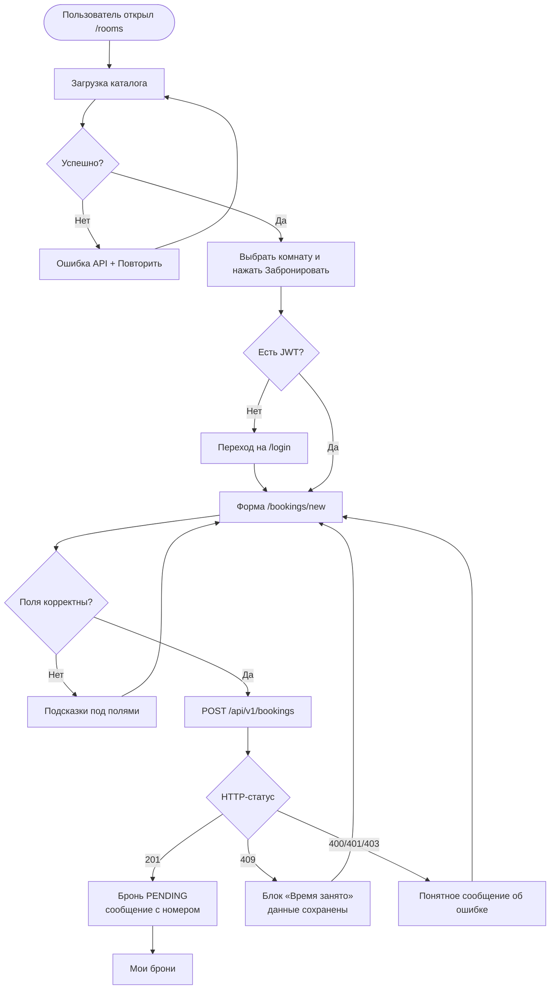

# UI-flow: экраны, маршруты и состояния

Документ описывает клиентскую часть приложения: какие экраны существуют, как
пользователь перемещается между ними, что видит при загрузке, ошибке и пустом
результате. Связан с требованиями [01-requirements.md](01-requirements.md),
контрактом [interface-contract.md](interface-contract.md) и картой API
[api-contract.md](api-contract.md).

## 1. Роли и доступ

| Маршрут | Экран | Доступ |
|---|---|---|
| `/login` | Вход | Публичный |
| `/register` | Регистрация | Публичный |
| `/rooms` | Каталог комнат и фильтры | Публичный просмотр; бронирование требует входа |
| `/rooms/:roomId` | Карточка комнаты и отзывы | Публичный |
| `/bookings` | Мои брони и история | Только авторизованный `EMPLOYEE` |
| `/bookings/new` | Создание брони | Только авторизованный `EMPLOYEE` |
| `/admin/rooms` | Управление комнатами | Только `ADMIN` |
| `*` | Страница 404 | Публичный |

Защита маршрутов реализована компонентами
[`RequireAuth` и `RequireAdmin`](../frontend/src/auth/RequireAuth.jsx):

- неавторизованный пользователь перенаправляется на `/login`, а после входа
  возвращается на исходный маршрут (`location.state.from`);
- сотрудник, открывший `/admin/rooms`, перенаправляется в каталог с
  уведомлением «Недостаточно прав»;
- JWT и данные пользователя хранятся в `localStorage` под ключом
  `coworking.session`.

## 2. Карта экранов

## 3. Экраны и состояния

Каждый экран с данными использует четыре состояния: `loading`, `error`,
`empty`, `ready`. Состояния не смешиваются: при ошибке не показываются старые
данные как новые, при пустом результате не показывается ошибка.

### 3.1. Вход и регистрация

- Поля: email, пароль; при регистрации — имя и фамилия.
- Клиентская проверка: обязательные поля, пароль не короче 8 символов.
- Ошибка API: блок «Не удалось войти» с текстом; при `401` — «Неверный email
  или пароль», при `400` — сообщение сервера.
- Успех: JWT сохранён, переход в каталог или на маршрут, с которого пришёл
  пользователь.
- В демонстрационном режиме на экране входа показаны тестовые учётные записи.

### 3.2. Каталог комнат (FR-5, FR-2)

- Фильтры: вместимость, оборудование, дата, время начала и окончания.
- Кнопки: «Искать», «Сбросить».
- `loading`: «Загружаем каталог…».
- `error`: «Не удалось загрузить каталог», текст ошибки, кнопка «Повторить».
- `empty`: «Подходящих комнат нет» с перечислением активных фильтров и кнопкой
  сброса.
- `ready`: сетка карточек, счётчик найденных комнат; у карточки — название,
  вместимость, оборудование и кнопки «Подробнее» / «Забронировать».
- Ошибки клиентской валидации фильтров: пустая дата без времени, дата в
  прошлом, `timeFrom >= timeTo`, неположительная вместимость.

### 3.3. Карточка комнаты (FR-5, FR-8)

- Показывает название, вместимость, оборудование и отзывы со средней оценкой.
- Кнопка «Забронировать» ведёт на `/bookings/new?roomId=...`.
- Если отзывы не загрузились, карточка комнаты остаётся доступной, а список
  отзывов показывается пустым — отказ второстепенного запроса не ломает экран.

### 3.4. Создание брони (FR-3)

- Комната выбирается из списка, дата — не в прошлом, время начала и окончания
  проверяются на `timeFrom < timeTo`.
- Перед отправкой показывается выбранная комната и её вместимость.
- `201`: блок «Бронь создана» с номером и статусом `PENDING`, ссылка на
  «Мои брони».
- `400`: «Не удалось создать бронь» с текстом ошибки.
- `401`: сообщение об истёкшей сессии и ссылка «Войти снова».
- `403`: «Недостаточно прав для этой операции».
- `409`: отдельный блок «Выбранное время уже занято», ответ сервера и
  подсказка изменить время; данные формы сохраняются.

Подробный контракт — в [interface-contract.md](interface-contract.md).

### 3.5. Мои брони (FR-6, FR-4, FR-8)

- Вкладки «Активные» и «История»; запросы `GET /api/v1/bookings/me?scope=...`.
- Карточка брони: комната, дата, интервал, номер заявки, статус.
- Действия: «Отменить» для `PENDING`/`CONFIRMED`, «Оставить отзыв» для
  `COMPLETED`.
- Отмена вызывает `PATCH /api/v1/bookings/{id}/cancel`; при успехе показывается
  уведомление, список перезагружается.
- Ошибка отмены (`403`, `409`) показывается блоком «Действие не выполнено»;
  статус брони не меняется.
- Форма отзыва: оценка `1..5`, комментарий до 500 символов; после сохранения
  кнопка заменяется на «Отзыв оставлен».

### 3.6. Управление комнатами (FR-7)

- Форма «Новая комната» / «Редактирование комнаты»: название, вместимость,
  оборудование.
- Клиентская проверка: непустое название, вместимость — целое число от 1.
- Список комнат с пометкой «В архиве»; действия «Изменить» и «Архивировать».
- Ошибки `400`/`403` показываются блоком с ответом сервера.

### 3.7. Страница 404

- Заголовок «Страница не найдена» и ссылка «В каталог».

## 4. Сквозной сценарий бронирования

## 5. Правила отображения ошибок

- Все ошибки — человекочитаемые; технический ответ сервера показывается
  отдельной строкой «Ответ сервера».
- `401` всегда содержит действие «Войти снова».
- `403` объясняет нехватку прав, а не «ошибку сервера».
- `409` при бронировании — не общая ошибка, а конфликт времени: форма
  остаётся заполненной, пользователь может выбрать другой слот.
- Сетевые ошибки предлагают проверить запуск backend и повторить запрос.
- Ошибки объявляются через `role="alert"`, успехи — через `role="status"`,
  чтобы они были доступны скринридеру.

## 6. Демонстрационный режим

Если backend ещё не реализует часть API (FR-1, FR-2), frontend можно запустить
с `VITE_MOCK_API=true`. В этом режиме Vite поднимает встроенный mock API с
тестовыми комнатами, бронями и отзывами; контракт `POST /api/v1/bookings`,
включая `409`, сохраняется. По умолчанию режим выключен, и приложение работает
с настоящим backend через прокси `/api`.

Тестовые учётные записи:

| Роль | Email | Пароль |
|---|---|---|
| `EMPLOYEE` | `employee@example.com` | `Secret123!` |
| `ADMIN` | `admin@example.com` | `Secret123!` |

## 7. Известные ограничения

- Backend на момент ЛР №3--4 реализует только `POST /api/v1/bookings`; вход,
  каталог, отмена, отзывы и административные операции описаны контрактом, но
  ещё не реализованы на сервере. Поэтому сквозной сценарий в браузере
  проверяется в демонстрационном режиме.
- Административный список комнат запрашивает `GET /api/v1/rooms?includeArchived=true`;
  параметр согласован с mock API и должен быть поддержан backend при
  реализации FR-7.
- JWT хранится в `localStorage`; для production рекомендуется httpOnly-cookie
  или короткоживущий токен с refresh-механизмом.
